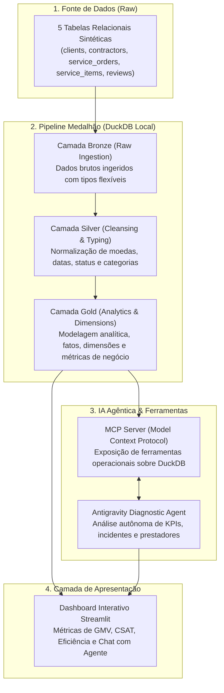

# HomeFix — Plataforma Analítica & IA Agêntica para Marketplace de Serviços

O **HomeFix** é uma solução completa de engenharia de dados, analytics e inteligência artificial agêntica para um marketplace de serviços residenciais e comerciais (manutenção hidráulica, elétrica, reformas, climatização, limpeza, entre outros).

O projeto adota a metodologia **Spec-Driven Development** (Desenvolvimento Orientado a Especificações), implementando uma **Arquitetura Medalhão (Bronze, Silver, Gold)** sobre o motor analítico de alto desempenho **DuckDB**, um servidor de IA baseado no **Model Context Protocol (MCP)** integrado ao agente **Antigravity**, um **Dashboard Interativo em Streamlit** e suíte de testes com cobertura superior a 90% (`pytest-cov`).

---

## 🏛️ Arquitetura do Sistema



---

## 📊 Glossário de Dados & Grãos Relacionais

O modelo é composto por 5 entidades relacionais rigorosamente conectadas por integridade referencial:

| Tabela | Grão (O que representa 1 linha) | Chave Primária (PK) | Chaves Estrangeiras (FK) |
| :--- | :--- | :--- | :--- |
| **`clients`** | 1 cliente cadastrado na plataforma | `client_id` (INT) | Nenhuma |
| **`contractors`** | 1 prestador autônomo credenciado | `contractor_id` (INT) | Nenhuma |
| **`service_orders`** | 1 ordem de serviço / chamado aberto | `order_id` (INT) | `client_id`, `contractor_id` |
| **`service_items`** | 1 tarefa ou peça dentro de uma ordem | `item_id` (INT) | `order_id` |
| **`reviews`** | 1 avaliação pós-serviço e reporte de incidentes | `review_id` (INT) | `order_id` |

> **Princípio de Integridade:** As chaves de ligação (`*_id`) são consistentes em 100% dos registros. Inconsistências e ruídos intencionais (datas despadronizadas, moedas em string, status não normalizados) são inseridos apenas em atributos descritivos e métricas brutas, simulando dados reais a serem sanitizados no pipeline.

---

## 📁 Estrutura do Repositório

```text
homefix/
├── specs/                     # Especificações técnicas de cada fase (Spec-Driven)
│   ├── spec-01-mock-data.md
│   ├── spec-02-medallion-pipeline.md
│   ├── spec-03-gold-analytics.md
│   ├── spec-04-mcp-agents.md
│   └── spec-05-dashboard.md
├── scripts/                   # Módulos operacionais do pipeline DuckDB
│   ├── connection.py          # Gerenciador de conexão singleton com DuckDB
│   ├── generate_mock_data.py  # Gerador dos 5 CSVs com erros controlados
│   ├── bronze_ingestion.py    # Carga raw CSV -> DuckDB (Schema Bronze)
│   ├── silver_processing.py   # Cleansing e tipagem -> DuckDB (Schema Silver)
│   ├── gold_processing.py     # Criação de views/tabelas analíticas (Schema Gold)
│   └── run_pipeline.py        # Orquestrador sequencial Bronze -> Silver -> Gold
├── data/
│   ├── raw/                   # [Git] 5 CSVs sintéticos com anomalias controladas
│   ├── queries/               # [Git] Consultas analíticas SQL (CTEs, Window Functions)
│   └── warehouse/             # [GitIgnore] Banco binário local homefix.duckdb
├── agents/                    # Camada de IA Agêntica Antigravity + MCP
│   ├── __init__.py
│   ├── mcp_server.py          # Servidor MCP expondo ferramentas de análise
│   ├── mcp_config.json        # Configuração de capacidades e transporte MCP
│   ├── tools.py               # Funções de execução das queries analíticas
│   └── bot.py                 # Agente de diagnóstico operacional
├── dashboard/                 # Interface visual com Streamlit
│   └── app.py
├── tests/                     # Suíte de testes automatizados (> 90% cobertura)
│   ├── test_generator.py
│   ├── test_pipeline.py
│   ├── test_sql_queries.py
│   ├── test_mcp_agents.py
│   └── test_dashboard_logic.py
├── pyproject.toml             # Configuração e dependências gerenciadas via uv
├── uv.lock                    # Lockfile de dependências exatas
├── pytest.ini                 # Configuração de testes com cobertura mínima de 90%
└── README.md                  # Documentação executiva do projeto
```

---

## 🛠️ Tecnologias Utilizadas

- **Gerenciador de Pacotes e Runtime:** [uv](https://github.com/astral-sh/uv) (ambiente ultrarrápido em Python 3.12+)
- **Banco de Dados Analítico:** [DuckDB](https://duckdb.org/) (processamento colunar in-process de altíssima performance)
- **Manipulação de Dados:** [Pandas](https://pandas.pydata.org/) & [Pydantic](https://docs.pydantic.dev/)
- **Protocolo de IA:** [Model Context Protocol (MCP)](https://modelcontextprotocol.io/)
- **Dashboard Interativo:** [Streamlit](https://streamlit.io/)
- **Testes & Qualidade:** [Pytest](https://pytest.org/), [pytest-cov](https://pytest-cov.readthedocs.io/) e [Ruff](https://astral.sh/ruff)

---

## 🚀 Como Executar o Projeto

### Pré-requisitos
Ter o [uv](https://docs.astral.sh/uv/getting-started/installation/) instalado na sua máquina.

### 1. Clonar e Instalar Dependências
```bash
git clone https://github.com/gabtei/homefix.git
cd homefix
uv sync
```

### 2. Gerar Dados Sintéticos (Fase 1)
```bash
uv run python scripts/generate_mock_data.py
```

### 3. Executar o Pipeline Medalhão (Bronze $\rightarrow$ Silver $\rightarrow$ Gold)
```bash
uv run python scripts/run_pipeline.py
```

### 4. Executar os Testes Automatizados (Cobertura > 90%)
```bash
uv run pytest
```

### 5. Iniciar o Dashboard Streamlit
```bash
uv run streamlit run dashboard/app.py
```

---

## 🔀 Fluxo Git e Política de Pull Requests (Git Flow)

O desenvolvimento segue rigorosamente o modelo de branches isoladas por fase:

```text
[feature/fase-0X] ──(Pull Request)──> [develop] ──(Pull Request Final)──> [main]
```

- **`main`**: Branch de produção e portfólio estável.
- **`develop`**: Branch de integração contínua.
- **`feature/fase-0X-...`**: Branches de ciclo de vida das 5 especificações técnicas.

---

## 📋 Fases de Desenvolvimento

1. **Fase 1: Mock Data Engine & Spec-01** — Geração de 5 tabelas relacionais com dados sintéticos realistas e inconsistências controladas.
2. **Fase 2: Arquitetura Medalhão (Bronze & Silver)** — Ingestão no DuckDB e higienização robusta (conversão de moedas, datas ISO e normalização categórica).
3. **Fase 3: Camada Gold & Consultas Analíticas** — Modelagem dimensional, CTEs, Window Functions e KPIs de negócio (GMV, CSAT, Churn, Resolução).
4. **Fase 4: IA Agêntica com MCP & Antigravity** — Implementação do servidor MCP e agente de diagnóstico operacional integrado.
5. **Fase 5: Dashboard Streamlit & Documentação Final** — Painel visual integrado, chat analítico e garantia de cobertura de testes superior a 90%.

---

## 👤 Autor

**Gabriel Teixeira**  
- GitHub: [@gabtei](https://github.com/gabtei)  
- E-mail: gt2kdez+cs@gmail.com
