# Especificação Técnica 02: Pipeline Medalhão — Ingestão Bronze & Tratamento Silver no DuckDB

## 1. Visão Geral e Arquitetura

Esta especificação define o pipeline de engenharia de dados da **HomeFix**, responsável pela ingestão dos dados brutos gerados na Fase 1 para a **Camada Bronze** e pela subsequente higienização, tipagem estrita e enriquecimento na **Camada Silver**, operando localmente no motor analítico colunar **DuckDB** (`data/warehouse/homefix.duckdb`).

```mermaid
flowchart LR
    subgraph Raw["Arquivos CSV Brutos (data/raw/)"]
        C1["clients.csv"]
        C2["contractors.csv"]
        C3["service_orders.csv"]
        C4["service_items.csv"]
        C5["reviews.csv"]
    end

    subgraph Bronze["Schema: bronze (DuckDB)"]
        B1["bronze.raw_clients"]
        B2["bronze.raw_contractors"]
        B3["bronze.raw_service_orders"]
        B4["bronze.raw_service_items"]
        B5["bronze.raw_reviews"]
    end

    subgraph Silver["Schema: silver (DuckDB)"]
        S1["silver.clients"]
        S2["silver.contractors"]
        S3["silver.service_orders"]
        S4["silver.service_items"]
        S5["silver.reviews"]
    end

    Raw -->|Carga Fiel + Auditoria| Bronze
    Bronze -->|Cleansing, Tipagem, Parsing| Silver
```



---

## 2. Camada Bronze: Ingestão Fiel (Raw Ingestion)

### 2.1 Princípios de Design
1. **Preservação Original:** Nenhum dado é transformado ou descartado na camada Bronze. Todas as colunas são carregadas exatamente como nos arquivos CSVs (`VARCHAR` para atributos com ruído).
2. **Metadados de Auditoria:** Cada registro ingerido recebe automaticamente a coluna `_ingested_at TIMESTAMP` indicando o momento exato da carga.
3. **Idempotência:** A reexecução do script de ingestão recria (`CREATE OR REPLACE TABLE`) as tabelas Bronze sem duplicar dados.

### 2.2 Tabelas Bronze
- `bronze.raw_clients`
- `bronze.raw_contractors`
- `bronze.raw_service_orders`
- `bronze.raw_service_items`
- `bronze.raw_reviews`

---

## 3. Camada Silver: Higienização, Padronização e Tipagem

A camada Silver transforma os dados brutos da Bronze em entidades confiáveis para análise, aplicando:

### 3.1 Regras de Sanitização de Tipos de Dados

#### 1. Padronização de Datas (`DATE`)
Os formatos heterogêneos (`YYYY-MM-DD`, `DD/MM/YYYY`, `MM-DD-YYYY`, `YYYY/MM/DD`) são convertidos para o tipo nativo `DATE` (`YYYY-MM-DD`) no DuckDB via cascata de parsers seguros:
```sql
COALESCE(
    TRY_STRPTIME(col_data, '%Y-%m-%d'),
    TRY_STRPTIME(col_data, '%d/%m/%Y'),
    TRY_STRPTIME(col_data, '%m-%d-%Y'),
    TRY_STRPTIME(col_data, '%Y/%m/%d')
)::DATE
```

#### 2. Padronização de Moedas (`DECIMAL(10,2)`)
Os valores com ruídos (`R$ 1.250,50`, `R$ 150.00`, `120,50`, `R$85`) são normalizados removendo símbolos (`R$`), espaços, tratando separadores de milhar e substituindo a vírgula decimal por ponto:
- Se contiver vírgula: remove ponto de milhar e substitui vírgula por ponto.
- Converte para `DECIMAL(10,2)`. Valores vazios ou nulos viram `0.00` ou `NULL` conforme semântica do campo (ex: `total_final_amount` para canceladas é `0.00`).

#### 3. Padronização de Booleanos (`BOOLEAN`)
Valores textuais (`TRUE`, `true`, `Sim`, `1`) convertidos para `TRUE`.  
Valores (`FALSE`, `false`, `Não`, `0`) convertidos para `FALSE`.

#### 4. Normalização Categórica e Textual
- **Especialidades:** Mapeadas com acentuação e caixa alta adequadas (`Elétrica`, `Hidráulica`, `Pintura`, `Climatização`, `Marcenaria`, `Alvenaria`, `Limpeza`).
- **Status de Ordens:** Normalizados em maiúsculas sem acentos (`CONCLUIDO`, `CANCELADO`, `EM_ANDAMENTO`, `ABERTO`).
- **Tipos de Itens:** Padronizados para `LABOR` (Mão de Obra) ou `PARTS` (Peças/Materiais).
- **Incidentes:** Classificados estritamente conforme taxonomia oficial (`Atraso excessivo`, `Dano material`, `Serviço incompleto`, `Cobrança indevida`, `Nenhum`).

---

## 4. Esquemas Finais da Camada Silver

### 4.1 `silver.clients`
- `client_id` `INTEGER` PRIMARY KEY
- `client_name` `VARCHAR`
- `client_email` `VARCHAR`
- `client_phone` `VARCHAR` (Normalizado: apenas 11 dígitos numéricos `DDD + 9 dígitos`)
- `client_city` `VARCHAR`
- `client_state` `VARCHAR`
- `signup_date` `DATE`
- `_processed_at` `TIMESTAMP`

### 4.2 `silver.contractors`
- `contractor_id` `INTEGER` PRIMARY KEY
- `contractor_name` `VARCHAR`
- `specialty` `VARCHAR` (Normalizada)
- `hourly_rate` `DECIMAL(10,2)`
- `experience_years` `INTEGER`
- `city` `VARCHAR`
- `state` `VARCHAR`
- `is_active` `BOOLEAN`
- `_processed_at` `TIMESTAMP`

### 4.3 `silver.service_orders`
- `order_id` `INTEGER` PRIMARY KEY
- `client_id` `INTEGER` (FK)
- `contractor_id` `INTEGER` (FK)
- `order_date` `DATE`
- `scheduled_date` `DATE`
- `completion_date` `DATE` (NULL quando cancelado/em andamento/aberto)
- `order_status` `VARCHAR` (`CONCLUIDO`, `CANCELADO`, `EM_ANDAMENTO`, `ABERTO`)
- `service_category` `VARCHAR` (Normalizada)
- `total_quoted_amount` `DECIMAL(10,2)`
- `total_final_amount` `DECIMAL(10,2)`
- `cancellation_reason` `VARCHAR` (NULL ou texto da justificativa)
- `_processed_at` `TIMESTAMP`

### 4.4 `silver.service_items`
- `item_id` `INTEGER` PRIMARY KEY
- `order_id` `INTEGER` (FK)
- `item_description` `VARCHAR`
- `item_type` `VARCHAR` (`LABOR` ou `PARTS`)
- `quantity` `INTEGER`
- `unit_price` `DECIMAL(10,2)`
- `total_price` `DECIMAL(10,2)`
- `_processed_at` `TIMESTAMP`

### 4.5 `silver.reviews`
- `review_id` `INTEGER` PRIMARY KEY
- `order_id` `INTEGER` (FK)
- `rating` `INTEGER` (1 a 5)
- `review_comment` `VARCHAR`
- `incident_reported` `BOOLEAN`
- `incident_type` `VARCHAR` (`Nenhum`, `Atraso excessivo`, etc.)
- `review_date` `DATE`
- `_processed_at` `TIMESTAMP`

---

## 5. Módulos Operacionais

1. **`scripts/connection.py`**: Gerenciador de conexão DuckDB, garantindo inicialização dos esquemas `bronze`, `silver`, `gold` e suportando conexões persistentes ou em memória (`:memory:`) para testes isolados.
2. **`scripts/bronze_ingestion.py`**: Ingestão automática de `data/raw/*.csv` para `bronze.raw_*`.
3. **`scripts/silver_processing.py`**: Transformação SQL declarativa de `bronze` para `silver`.
4. **`tests/test_pipeline.py`**: Testes de validação dos tipos finais, contagem de registros e ausência de regressões com cobertura superior a 90%.

