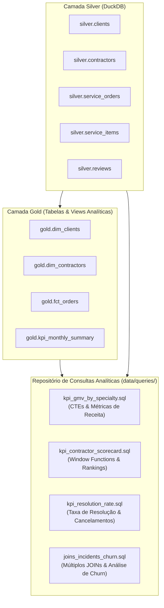

# Especificação Técnica 03: Camada Gold & Consultas Analíticas SQL

## 1. Visão Geral e Objetivos de Negócio

A Camada Gold representa o nível de consumo analítico da plataforma **HomeFix**. Sobre os dados higienizados e tipados da Camada Silver, a Camada Gold estrutura visões dimensionais e fatos analíticos para responder às perguntas centrais dos stakeholders do marketplace:
- **GMV (Gross Merchandise Value):** Qual o volume financeiro transacionado por especialidade e categoria de serviço?
- **Desempenho dos Prestadores (Scorecard):** Quem são os prestadores de melhor performance em termos de receita, nota média (CSAT) e volume de chamados?
- **Eficiência Operacional & Resolução:** Qual a taxa de sucesso/conclusão de ordens por categoria e quais os principais ofensores de cancelamento?
- **Impacto de Incidentes & Churn:** Como incidentes reportados em avaliações afetam a retenção de clientes e geram evasão da plataforma?

---

## 2. Modelagem da Camada Gold

### 2.1 `gold.dim_clients`
Tabela dimensional de clientes enriquecida com métricas de ciclo de vida (LTV e frequência):
- `client_id` (PK, INT)
- `client_name` (VARCHAR)
- `client_city` (VARCHAR)
- `client_state` (VARCHAR)
- `signup_date` (DATE)
- `total_orders_placed` (INT): Total histórico de chamados abertos pelo cliente.
- `completed_orders` (INT): Total de chamados concluídos com sucesso.
- `total_spend` (DECIMAL(10,2)): Valor total gasto no marketplace.
- `avg_order_value` (DECIMAL(10,2)): Ticket médio do cliente.
- `first_order_date` (DATE): Data da primeira ordem.
- `last_order_date` (DATE): Data da ordem mais recente.

### 2.2 `gold.dim_contractors`
Tabela dimensional de prestadores com métricas consolidadas de reputação e capacidade:
- `contractor_id` (PK, INT)
- `contractor_name` (VARCHAR)
- `specialty` (VARCHAR)
- `hourly_rate` (DECIMAL(10,2))
- `experience_years` (INT)
- `city` (VARCHAR)
- `is_active` (BOOLEAN)
- `total_orders_assigned` (INT): Total de chamados direcionados.
- `completed_orders` (INT): Total de chamados finalizados.
- `completion_rate_pct` (DECIMAL(5,2)): Taxa percentual de conclusão.
- `total_gmv_generated` (DECIMAL(10,2)): Volume transacionado pelo prestador.
- `avg_rating` (DECIMAL(3,2)): Nota média das avaliações recebidas.
- `incidents_count` (INT): Quantidade de incidentes operacionais atribuídos.

### 2.3 `gold.fct_orders`
Tabela fato analítica no grão de uma ordem de serviço, contendo métricas temporais e financeiras derivadas:
- `order_id` (PK, INT)
- `client_id` (FK, INT)
- `contractor_id` (FK, INT)
- `order_date` (DATE)
- `scheduled_date` (DATE)
- `completion_date` (DATE)
- `order_status` (VARCHAR)
- `service_category` (VARCHAR)
- `total_quoted_amount` (DECIMAL(10,2))
- `total_final_amount` (DECIMAL(10,2))
- `lead_time_days` (INT): Dias entre abertura do chamado e data agendada.
- `cycle_time_days` (INT): Dias entre abertura e conclusão (NULL se não concluído).
- `rating` (INT): Nota recebida (NULL se sem avaliação).
- `has_incident` (BOOLEAN): Indicador se houve reporte de incidente.

### 2.4 `gold.kpi_monthly_summary`
Visão consolidada temporal para acompanhamento executivo:
- `order_month` (VARCHAR 'YYYY-MM')
- `total_orders` (INT)
- `completed_orders` (INT)
- `canceled_orders` (INT)
- `completion_rate_pct` (DECIMAL(5,2))
- `total_gmv` (DECIMAL(10,2))
- `avg_ticket` (DECIMAL(10,2))
- `avg_rating` (DECIMAL(3,2))

---

## 3. Repositório de Consultas Analíticas (`data/queries/`)

### 3.1 `kpi_gmv_by_specialty.sql` (CTEs)
- **Propósito:** Calcular GMV total, volume de ordens concluídas, ticket médio e participação percentual de cada especialidade no GMV total da plataforma.
- **Técnicas SQL:** `WITH` (CTEs), funções de agregação (`SUM`, `COUNT`, `AVG`, `ROUND`) e cálculo de share percentual sobre o total acumulado.

### 3.2 `kpi_contractor_scorecard.sql` (Window Functions)
- **Propósito:** Classificar prestadores dentro de sua respectiva especialidade por volume financeiro e reputação.
- **Técnicas SQL:** Funções de janela (`ROW_NUMBER() OVER (PARTITION BY specialty ORDER BY total_gmv DESC)`, `DENSE_RANK()`, `AVG(rating) OVER (PARTITION BY specialty)` para comparação contra a média da categoria).

### 3.3 `kpi_resolution_rate.sql` (Agregações de Eficiência)
- **Propósito:** Analisar a taxa de conversão/resolução de chamados por categoria de serviço, apontando os principais motivos de cancelamento e o tempo médio de ciclo (dias até conclusão).
- **Técnicas SQL:** `CASE WHEN`, contagens condicionais, agregações estatísticas e ordenação por criticidade de taxa de perda.

### 3.4 `joins_incidents_churn.sql` (Múltiplos JOINs & Análise de Churn)
- **Propósito:** Correlacionar clientes que sofreram incidentes operacionais (avaliações negativas com dano material, atraso ou cobrança indevida) com o comportamento de recontratação ou abandono da plataforma.
- **Técnicas SQL:** `LEFT JOIN` entre 4 tabelas (`silver.clients`, `silver.service_orders`, `silver.contractors`, `silver.reviews`), identificação de clientes de compra única pós-incidente e métricas de risco financeiro.

---

## 4. Requisitos de Implementação e Qualidade
1. **Idempotência:** Scripts devem recriar (`CREATE OR REPLACE`) tabelas e views no esquema `gold` sem duplicação de dados.
2. **Reuso de Conexão:** Integração direta com `scripts/connection.py`.
3. **Validação Automatizada:** Testes em `tests/test_sql_queries.py` executando todos os arquivos SQL sobre DuckDB em memória e persistente, garantindo resultados não nulos, ausência de erros de sintaxe e aderência aos thresholds de cobertura de testes.
