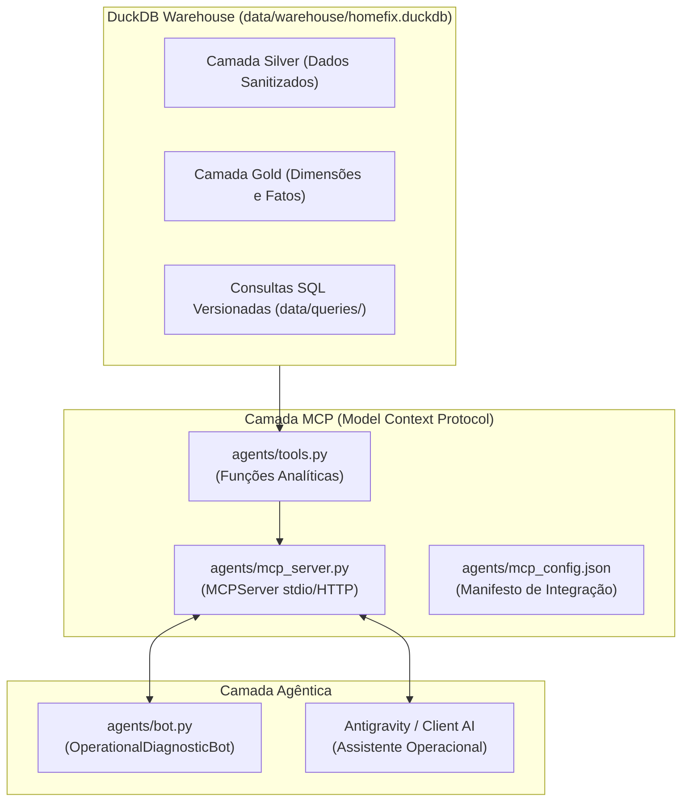

# Especificação Técnica 04: IA Agêntica com MCP & Antigravity

## 1. Visão Geral e Arquitetura

Esta especificação define a camada de Inteligência Artificial Agêntica do ecossistema **HomeFix**, fundamentada no **Model Context Protocol (MCP)** da Anthropic/Linux Foundation e no agente especialista de diagnóstico operacional integrado com o **Antigravity**.

A arquitetura desacopla a camada analítica de dados da camada conversacional:
- O **Servidor MCP** expõe ferramentas de consulta sobre o banco DuckDB (`gold` e `silver`), utilizando as consultas analíticas versionadas em `data/queries/`.
- O **Diagnostic Agent** atua como um analista de dados autônomo, consumindo as ferramentas MCP para diagnosticar gargalos operacionais, riscos de perda de receita (GMV) e evasão de clientes (churn).



---

## 2. Catálogo de Ferramentas MCP

O servidor `MCPServer` disponibiliza 5 ferramentas especializadas para o ecossistema agêntico:

### 2.1 `get_gmv_by_specialty`
- **Descrição:** Retorna volume financeiro bruto (GMV), ticket médio e percentual de representatividade por especialidade de serviço.
- **Parâmetros:**
  - `min_orders` (int, default=0): Filtro de volume mínimo de chamados.
- **Retorno:** Lista de dicionários contendo `specialty`, `total_orders`, `completed_orders`, `total_gmv`, `avg_ticket` e `share_of_total_gmv_pct`.

### 2.2 `get_contractor_scorecard`
- **Descrição:** Retorna o scorecard de prestadores com rankings por especialidade e no marketplace geral, calculados com Window Functions.
- **Parâmetros:**
  - `specialty` (str, opcional): Filtrar por especialidade específica (ex: 'Elétrica').
  - `min_rating` (float, default=0.0): Filtrar prestadores com nota média igual ou superior.
- **Retorno:** Lista de registros com métricas consolidadas, rankings e comparações com a média da categoria.

### 2.3 `get_resolution_rate`
- **Descrição:** Analisa a eficiência operacional e taxa de conversão (conclusão vs cancelamento) e tempo de ciclo por categoria.
- **Parâmetros:**
  - `min_cancellation_pct` (float, default=0.0): Filtrar categorias com taxa de cancelamento superior ao limiar informado.
- **Retorno:** Métricas de resolução, cancelamento e lead time em dias.

### 2.4 `get_incidents_churn`
- **Descrição:** Mapeia incidentes operacionais reportados em avaliações e classifica clientes sob risco de abandono (churn).
- **Parâmetros:**
  - `churn_status` (str, opcional): Filtrar por `'ALTO_RISCO_CHURN'` ou `'RETIDO'`.
- **Retorno:** Detalhamento do incidente, prestador alocado, nota e status de risco do cliente.

### 2.5 `diagnose_marketplace_health`
- **Descrição:** Ferramenta executiva que roda uma bateria de checagens consolidadas sobre o marketplace, identificando:
  - Saúde geral do GMV e volume de pedidos;
  - Categorias com cancelamentos anômalos;
  - Prestadores com alta taxa de incidentes ou notas abaixo da média;
  - Resumo de clientes em alto risco de churn.
- **Retorno:** Relatório estruturado em formato JSON com indicadores chave e alertas operacionais.

---

## 3. Protocolo de Transporte e Configuração (`agents/mcp_config.json`)

O servidor MCP opera via protocolo padrão `stdio`, compatível com a suíte Antigravity, Claude Desktop e editores habilitados com MCP:
```json
{
  "mcpServers": {
    "homefix-analytics": {
      "command": "uv",
      "args": ["run", "python", "agents/mcp_server.py"],
      "env": {
        "PYTHONUNBUFFERED": "1"
      }
    }
  }
}
```

---

## 4. Agente de Diagnóstico Operacional (`agents/bot.py`)

A classe `OperationalDiagnosticBot` consome as ferramentas analíticas e implementa lógica heurística para:
1. **Triagem de Alertas:** Identificar especialidades onde a taxa de cancelamento excede 15%.
2. **Auditoria de Qualidade:** Localizar prestadores com CSAT médio inferior a 3.5 ou com múltiplos incidentes reportados.
3. **Plano de Contenção de Churn:** Mapear clientes afetados por danos materiais ou cobranças indevidas para contato prioritário do time de Customer Success.
4. **Relatório Executivo:** Sintetizar diagnósticos em texto claro e estruturado em Markdown para exibição no dashboard ou chat interativo.
