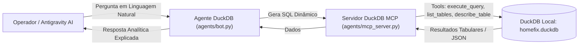

# Especificação Técnica 04: Servidor MCP do DuckDB & Agente Conversacional

## 1. Visão Geral e Arquitetura

Esta especificação define o **Servidor MCP do DuckDB (DuckDB MCP Server)** e o **Agente Conversacional** da plataforma **HomeFix**.

O objetivo central é permitir que qualquer cliente MCP (como o **Antigravity**, Claude Desktop, Cursor ou a interface do usuário) conecte-se ao banco de dados analítico local `data/warehouse/homefix.duckdb` e execute consultas SQL dinâmicas a partir de perguntas em linguagem natural feitas pelos operadores.



---

## 2. Catálogo de Ferramentas do DuckDB MCP

O servidor `MCPServer` expõe as ferramentas nativas de exploração e consulta do DuckDB:

### 2.1 `execute_query(query: str) -> str`
- **Descrição:** Executa qualquer consulta SQL `SELECT` arbitrária no banco de dados DuckDB (`data/warehouse/homefix.duckdb`) e retorna o resultado formatado em JSON.
- **Parâmetros:**
  - `query` (`str`): Consulta SQL a ser executada.
- **Segurança:** Bloqueia comandos destrutivos (`DROP`, `DELETE`, `TRUNCATE`) quando em modo de consulta analítica.

### 2.2 `list_tables() -> str`
- **Descrição:** Lista todos os esquemas (`bronze`, `silver`, `gold`) e todas as tabelas existentes no banco de dados com a contagem aproximada de linhas.
- **Retorno:** JSON com esquemas, nomes de tabelas e tipos.

### 2.3 `describe_table(table_name: str) -> str`
- **Descrição:** Retorna a estrutura detalhada de colunas e tipos de dados de uma tabela específica (ex: `gold.fct_orders` ou `silver.contractors`).
- **Parâmetros:**
  - `table_name` (`str`): Nome qualificado da tabela (ex: `gold.fct_orders`).

### 2.4 `get_schema_context() -> str`
- **Descrição:** Retorna a documentação consolidada do catálogo de dados de todos os esquemas (`silver` e `gold`), fornecendo ao modelo de IA o contexto necessário para traduzir perguntas em linguagem natural em queries SQL sem alucinações.

---

## 3. Configuração do Servidor MCP (`agents/mcp_config.json`)

```json
{
  "mcpServers": {
    "duckdb-homefix": {
      "command": "uv",
      "args": ["run", "python", "agents/mcp_server.py"],
      "env": {
        "PYTHONUNBUFFERED": "1"
      }
    }
  }
}
```

---

## 4. Agente DuckDB (`agents/bot.py`)

A classe `DuckDBAnalystBot`:
1. Utiliza o contexto do catálogo de dados (`get_schema_context`) para mapear perguntas de negócio em queries SQL precisas.
2. Executa a query resultante no DuckDB via `execute_query`.
3. Interpreta e sintetiza a resposta em linguagem natural e tabelas Markdown amigáveis para visualização no dashboard ou chat.
