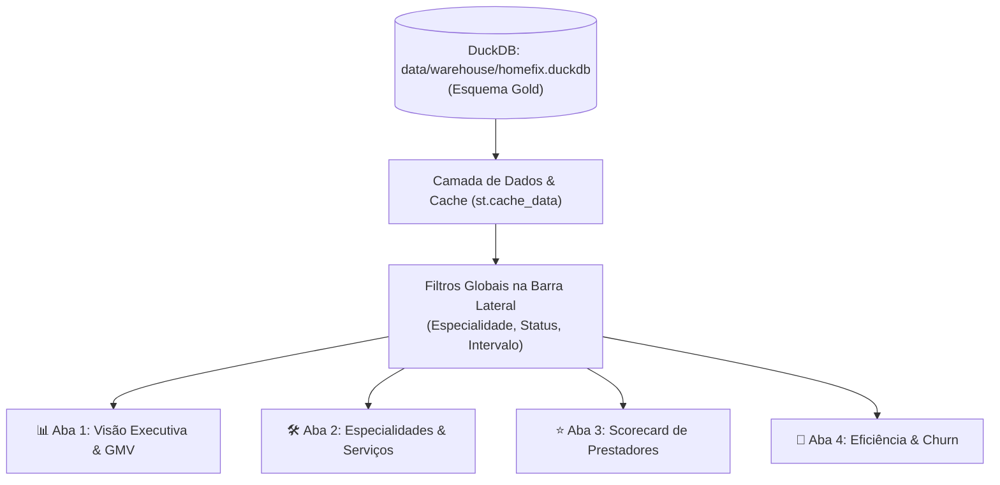

# Especificação Técnica 05: Dashboard Analítico em Streamlit & Orquestração Geral

## 1. Visão Geral e Propósito

Esta especificação define a interface visual analítica desenvolvida em **Streamlit** (`dashboard/app.py`) e o orquestrador sequencial do pipeline de dados (`scripts/run_pipeline.py`) para a plataforma **HomeFix**.

O painel é voltado para gestores de operações, diretores de negócio e tomadores de decisão do marketplace, centralizando métricas de faturamento (GMV), eficiência na entrega de serviços, rankings de prestadores e diagnóstico de retenção de clientes.

> **Diretriz de Design:** O painel é estritamente analítico (KPIs, gráficos de tendência, rankings e tabelas interativas com filtros), sem interface de chat conversacional.

---

## 2. Orquestrador do Pipeline (`scripts/run_pipeline.py`)

O módulo `scripts/run_pipeline.py` atua como o ponto de entrada único para o processamento em lote da Arquitetura Medalhão:
1. **Etapa 1 (Bronze):** Ingestão fiel dos CSVs brutos de `data/raw/` para `bronze.raw_*`.
2. **Etapa 2 (Silver):** Sanitização de moedas, conversão de datas para `DATE`, normalização de booleanos, status e categorias.
3. **Etapa 3 (Gold):** Construção das dimensões analíticas (`dim_clients`, `dim_contractors`), tabela fato (`fct_orders`) e sumário executivo (`kpi_monthly_summary`).

---

## 3. Arquitetura do Dashboard Streamlit (`dashboard/app.py`)

---

## 4. Estrutura e Seções do Dashboard

### 4.1 Barra Superior & Métricas Principais (Executive Header Cards)
- **GMV Total Acumulado (R$):** Volume transacionado em ordens concluídas.
- **Chamados Totais:** Volume total de ordens abertas na plataforma.
- **Taxa Global de Conclusão (%):** Percentual de sucesso na resolução de serviços.
- **Ticket Médio Geral (R$):** Valor médio gasto por chamado concluído.
- **Índice de Incidentes (%):** Percentual de ordens que resultaram em reporte de incidentes.

### 4.2 Abas Analíticas

#### 📊 Aba 1: Visão Executiva & Faturamento
- Gráfico de linha/área com a evolução mensal de GMV (`gold.kpi_monthly_summary`).
- Gráfico comparativo de volume de chamados concluídos vs cancelados mês a mês.
- Tabela analítica resumida da evolução temporal da plataforma.

#### 🛠️ Aba 2: Desempenho por Especialidade
- Gráfico de barras horizontais com o GMV gerado por categoria de serviço (`kpi_gmv_by_specialty.sql`).
- Distribuição percentual do market share de cada especialidade.
- Ticket médio por especialidade.

#### ⭐ Aba 3: Scorecard & Ranking de Prestadores
- Filtro interativo por especialidade de atendimento.
- Tabela com ranking de prestadores ordenados por GMV gerado e nota média de CSAT (`gold.dim_contractors`).
- Destaque para top performers (badges de liderança por categoria).

#### 🚨 Aba 4: Eficiência Operacional, Cancelamentos e Churn
- Gráfico com taxa de resolução vs cancelamento por categoria de serviço.
- Tempo médio de ciclo (lead time em dias) até a conclusão do chamado.
- Tabela com clientes impactados por incidentes operacionais classificados sob risco de evasão (`ALTO_RISCO_CHURN`), com ação recomendada para Customer Success.

---

## 5. Requisitos de Qualidade e Testes
- Métodos do dashboard modularizados para permitir testes automatizados da lógica de agregação em `tests/test_dashboard_logic.py`.
- Cobertura global de testes superior a 90% em toda a base de código (`pytest-cov`).

